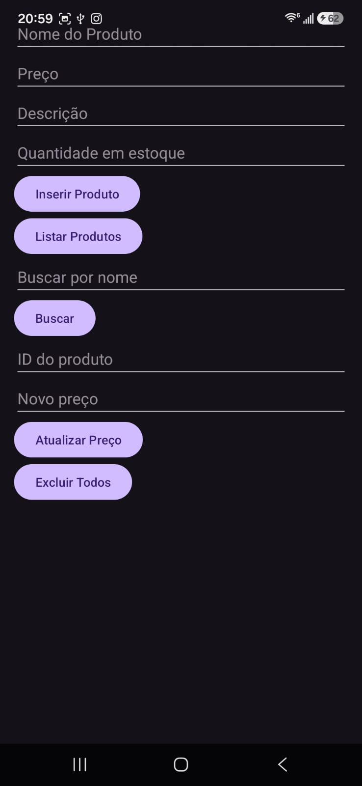
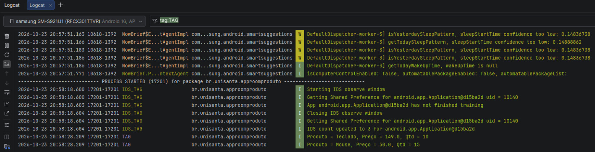
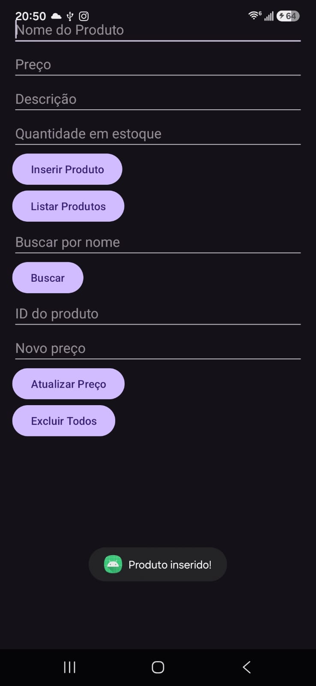
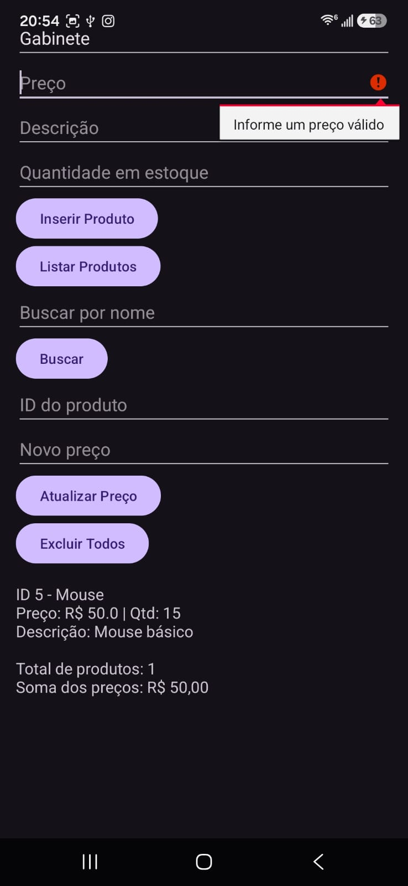
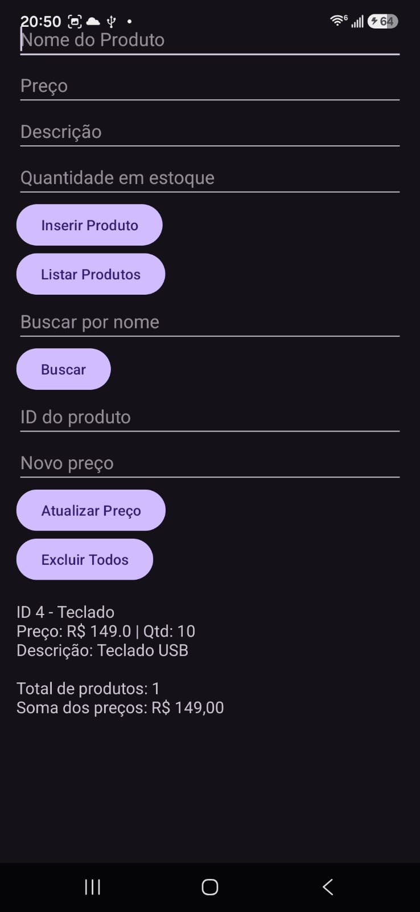
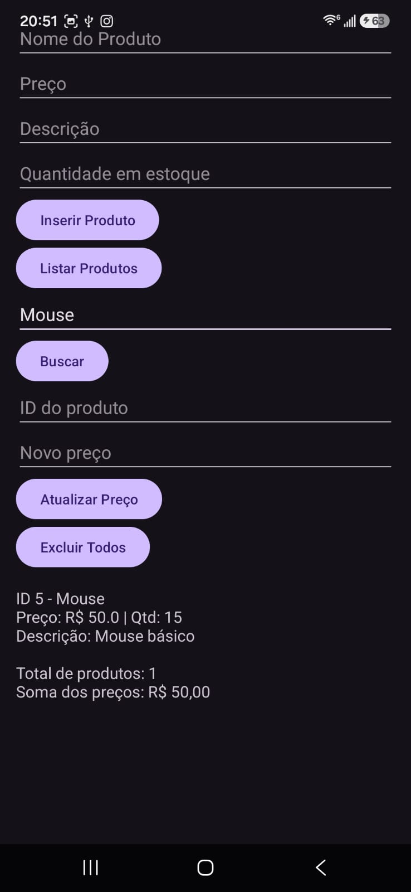
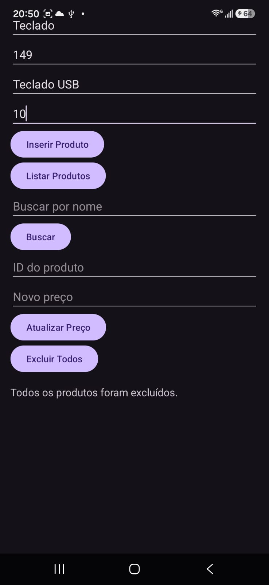
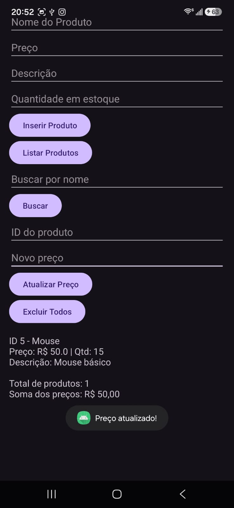

# AppRoomProduto: Cadastro de Produtos com Room SQLite
**Aluno(a):** Daniel de França Cunha
**RA:** 237045
**Disciplina:** Programação para Dispositivos Móveis
**Professor(a):** Alessandro Lima
## Sobre o projeto
Aplicativo Android em Kotlin que cadastra e lista produtos
usando persistência local com Room (SQLite).
## Tecnologias
- Kotlin
- Room 2.6.1 (SQLite)
- ViewBinding
- Corrotinas (lifecycleScope)
## Prints do app
Tela Inicial



Logcat

## Parte A: Complemento prático
### A1. Limpar campos após inserir
O que foi feito: adicionado ''clear''' ao final de todos os campos para esvaziar as caixas de texto

Trecho de código:
```kotlin
private fun inserirProduto() {
    val name = binding.editProductName.text.toString()
    val priceText = binding.editProductPrice.text.toString()
    val description = binding.editProductDescription.text.toString()
    val quantityText = binding.editProductQuantity.text.toString()

    if (name.isEmpty()) {
        binding.editProductName.error = "Informe o nome"
        return
    }

    val price = priceText.toDoubleOrNull()
    if (price == null || price <= 0.0) {
        binding.editProductPrice.error = "Informe um preço válido"
        return
    }

    val quantity = quantityText.toIntOrNull() ?: 0
    val product = Product(
        name = name,
        price = price,
        description = description,
        quantity = quantity
    )

    lifecycleScope.launch {
        productDao.insertAll(product)
        Toast.makeText(this@MainActivity, "Produto inserido!", Toast.LENGTH_SHORT).show()

        binding.editProductName.text.clear()
        binding.editProductPrice.text.clear()
        binding.editProductDescription.text.clear()
        binding.editProductQuantity.text.clear()
        binding.editProductName.requestFocus()
    }
}
```
Print: 

### A2. Validação de preço
O que foi feito: criada condição ''if'' para validação numérica a ser inserida

Trecho de código:
```kotlin
val price = priceText.toDoubleOrNull()
if (price == null || price <= 0.0) {
    binding.editProductPrice.error = "Informe um preço válido"
    return
}
```
Print:    


### A3. Lista na tela
O que foi feito: criado botão de listar produtos no XML

Trecho de código:
```kotlin
<Button
android:id="@+id/btnListarProdutos"
android:layout_width="wrap_content"
android:layout_height="wrap_content"
android:text="Listar Produtos"/>
```
Print:    


### A4. Total de Estoque
O que foi feito: com products.size, listamos quantos produtos são cadastrados

Trecho de código:
```kotlin
val total = products.sumOf { it.price }
texto.append("Total de produtos: ${products.size}\n")
texto.append("Soma dos preços: R$ ${String.format("%.2f", total)}")
```
Print:    )
Mesmo print do A3 pois é possível ver a quantidade de produtos listada.


### A5. Buscar por nome
O que foi feito: busca por nome no MainActivity e na DAO.

Trecho de código:
```kotlin
 @Query("SELECT * FROM product WHERE name LIKE :nome")
suspend fun buscarPorNome(nome: String): List<Product>
```
```kotlin
private fun buscarProdutos() {
val texto = binding.editBusca.text.toString()
lifecycleScope.launch {
val products = productDao.buscarPorNome("%$texto%")
mostrarLista(products)
}
}
```

Print:    


### A6. Excluir produtos
O que foi feito: assim como no A5, edições no MainActivity e na DAO. 

Trecho de código:
```kotlin
 @Query("DELETE FROM product")
suspend fun deleteAll()
```
```kotlin
private fun excluirTodos() {
lifecycleScope.launch {
productDao.deleteAll()
binding.textResultado.text = "Todos os produtos foram excluídos."
Toast.makeText(this@MainActivity, "Produtos excluídos!", Toast.LENGTH_SHORT).show()
}
}
```
Print:    


### A7. Atualizar produtos
O que foi feito: também na DAO e MainActivity a criação da opção de atualização.

Trecho de código:
```kotlin
@Query("SELECT * FROM product WHERE id = :id")
suspend fun buscarPorId(id: Int): Product?
```
```kotlin
lifecycleScope.launch {
    val produto = productDao.buscarPorId(id)
    if (produto == null) {
        Toast.makeText(this@MainActivity, "Produto não encontrado!", Toast.LENGTH_SHORT).show()
    } else {
        productDao.update(produto.copy(price = novoPreco))
        Toast.makeText(this@MainActivity, "Preço atualizado!", Toast.LENGTH_SHORT).show()
        binding.editProductId.text.clear()
        binding.editNovoPreco.text.clear()
    }
}
```
Print:    


### A8. Novo campo na tabela
O que foi feito: criação dos atributos; respondendo a pergunta, os produtos cadastrados somem, ou seja, a lista vem vazia.

Trecho de código:
```kotlin
data class Product(
    @PrimaryKey(autoGenerate = true) val id: Int = 0,
    @ColumnInfo(name = "name") val name: String,
    @ColumnInfo(name = "price") val price: Double,
    @ColumnInfo(name = "description") val description: String?,
    @ColumnInfo(name = "quantity") val quantity: Int
)
```
```kotlin
@Database(entities = [Product::class], version = 2)
```

## Parte B: Questões dissertativas
### B1. O que é persistência de dados...?
Resposta: Persistência é basicamente guardar os dados de forma com que eles sobrevivam quando o app for fechado ou quando o celular for reiniciado por exemplo. A MutableList é algo que só vive na RAM, então ela se perde quando o app é fechado. Um exemplo engraçado é que se você girar a tela com uma MutableList os dados se perderiam também, pois a Activity é recriada. Tudo isso comprova a experiência que eu tive com o app: ao abrir e fechar, os dados continuam lá. 
(repita para B2 até B8)
### B2. Qual é a diferença entre usar o SQLite diretamente...?
Resposta: A maior diferença, na minha opinião, é a abstração. Quando usando o o SQLite tradicional ele exige que você escreva comandos SQL manuais em texto e gerencie o banco de dados de forma manual, enquanto o Room é uma biblioteca de ''persistência''' que funciona como uma camada superior sobre o SQLite, mapeando objetos do Kotlin diretamente para as tabelas do banco de dados de forma muito mais segura e simples. Uma vantagem é que o Room gera o SQL sozinho de acordo com o comando (@Insert, @Update, etc). Outra vantagem é que quando o Room dá erro ele verifica logo na compilação; no SQLite ele roda e crasha.
### B3. O que é persistência de dados...?
Resposta: A Entity é uma classe que representa a tabela do banco. Nesse projeto é a Product, onde cada atributo vira uma coluna e o id é a ''chave primária''' gerada automaticamente. O DAO é a interface que define as operações que dá pra fazer no banco; no projeto é o ProductDao. O Database é a classe AppDatabase, que junta basicamente tudo: ela lista as entidades, define a versão do banco e entrega o DAO pela função productDao(). A relação funciona assim: a MainActivity cria o banco com o Room.databaseBuilder, pede o DAO ao banco e usa o DAO para executar as operações, que trabalham com objetos Product. Resumindo, a Entity é a estrutura da tabela, o DAO são as ações e o Database é o que conecta e cria o arquivo do banco.
### B4. Por que o Android não permite acessar o banco na thread principal? O que é ANR? Como suspend e lifecycleScope.launch resolvem esse problema?
Resposta: A thread principal é a responsável por desenhar a tela e responder aos toques do usuário. Como acessar o banco envolve ler e escrever em disco, que pode demorar, fazer isso nela poderia deixar o app travado, então o Room bloqueia essas consultas na thread principal. Se a thread principal fica ocupada por tempo demais, o Android mostra o erro ANR (Application Not Responding), a mensagem de que o app não está respondendo, e o usuário pode fechá-lo. Para resolver, as funções do meu DAO são suspend e eu as chamo dentro do lifecycleScope.launch, que abre uma corrotina. Assim o trabalho do banco acontece em segundo plano, a thread principal continua livre e a tela não trava. Quando o resultado fica pronto, a corrotina continua de onde parou. Além disso, o lifecycleScope é ligado à vida da Activity, então a corrotina é cancelada automaticamente se a tela for fechada.

### B5. O que faz o fallbackToDestructiveMigration()? Por que é perigoso em um app publicado? O que seria uma Migration?

Resposta: O fallbackToDestructiveMigration() diz ao Room que, quando a versão do banco mudar (por exemplo, quando adicionamos a coluna quantity e aumentamos a version de 1 para 2), ele deve apagar o banoc antigo e criar um novo vazio, em vez de dar erro. Durante o desenvolvimento isso é bem prático, e foi o que aconteceu no A8: os produtos que eu tinha cadastrado antes sumiram. Em um app publicado na Play Store isso é muito perigoso, porque cada atualização que mudasse a estrutura do banco apagaria os dados de todos os usuários, que perderiam suas informações sem aviso. Uma Migration é um código que ensina o Room a passar de uma versão do banco para outra preservando os dados, por exemplo um comando SQL que adiciona a coluna nova na tabela que já existe e mantém os produtos cadastrados. Num app real, o correto é escrever a Migration em vez de usar a opção destrutiva.

### B6. Qual é a vantagem do ViewBinding em relação ao findViewById? Que tipo de erro ele ajuda a evitar?

Resposta: Com o findViewById eu preciso procurar cada componente da tela pelo id, muitas vezes informando o tipo, e se eu digitar o id errado ou procurar um componente que não existe naquele layout, o app só descobre o problema ao rodar, podendo travar com um NullPointerException ou um erro de tipo. Com o ViewBinding, o Android gera automaticamente a classe ActivityMainBinding, com uma referência pronta para cada componente do layout que tem id, e eu acesso com binding.editProductName, por exemplo. A principal vantagem é a segurança: o tipo do componente já vem certo, e se eu escrever um nome que não existe o erro aparece na compilação, antes de rodar o app. Isso ajuda a evitar erros de id inexistente, de tipo errado e de valores nulos. Outra vantagem é que o código fica menor e mais fácil de ler, sem precisar de vários findViewById no começo da Activity.

### B7. Por que em apps maiores é recomendado criar o banco como Singleton? O que poderia acontecer se várias telas criassem cada uma o seu banco?

Resposta: Singleton significa ter uma única instância do banco para o app inteiro, que todas as telas reutilizam. Isso é recomendado porque criar uma instância do banco é uma operação pesada, que abre o arquivo e prepara as conexões, então ter várias gasta memória e processamento à toa. Se cada tela criasse o seu próprio banco, haveria várias conexões abertas para o mesmo arquivo, o que pode causar conflitos quando duas delas tentam escrever ao mesmo tempo, travamentos e até dados inconsistentes, já que uma tela poderia mostrar informações desatualizadas porque a outra instância alterou o banco. No meu projeto isso já acontece em pequena escala: o banco é criado dentro da MainActivity, então ele é criado de novo toda vez que a Activity é recriada, como ao girar a tela. Num app com várias telas o problema seria bem maior, por isso o ideal seria criar o banco uma única vez e reutilizá-lo.

### B8. Reflexão pessoal

Resposta: A principal dificuldade que eu tive foi com a configuração do Gradle, antes mesmo de chegar no código do Room. O tutorial usa o plugin kotlin-kapt, mas meu Android Studio é uma versão mais nova, com Kotlin embutido, e o plugin deu erro de incompatibilidade na sincronização. Para resolver, troquei o kotlin-kapt pelo legacy-kapt, que é o plugin indicado para esse caso. Depois ainda apareceu um erro de versão: o Room 2.6.1 do tutorial não conseguia ler os metadados do Kotlin mais novo, e a solução foi atualizar o Room para a versão 2.8.5. Outra dificuldade foi conectar todas as partes do projeto (layout, MainActivity, DAO, banco e entidade) e saber em qual arquivo cada coisa deveria ficar, mas separar em pacotes model, dao, db e view me ajudou a entender melhor a função de cada um. Um app real em que o Room seria útil é um app de controle de estoque para uma loja pequena, bem parecido com o que eu fiz. Eu teria tabelas de Produto, Fornecedor e Movimentação (entradas e saídas), e guardaria tudo no celular, o que permite usar o app mesmo sem internet e com respostas rápidas, já que os dados ficam no próprio aparelho.